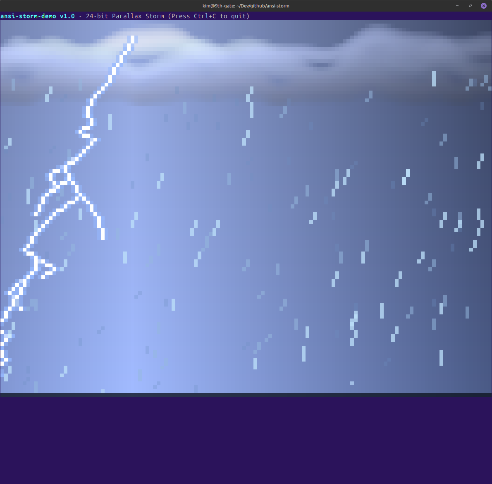
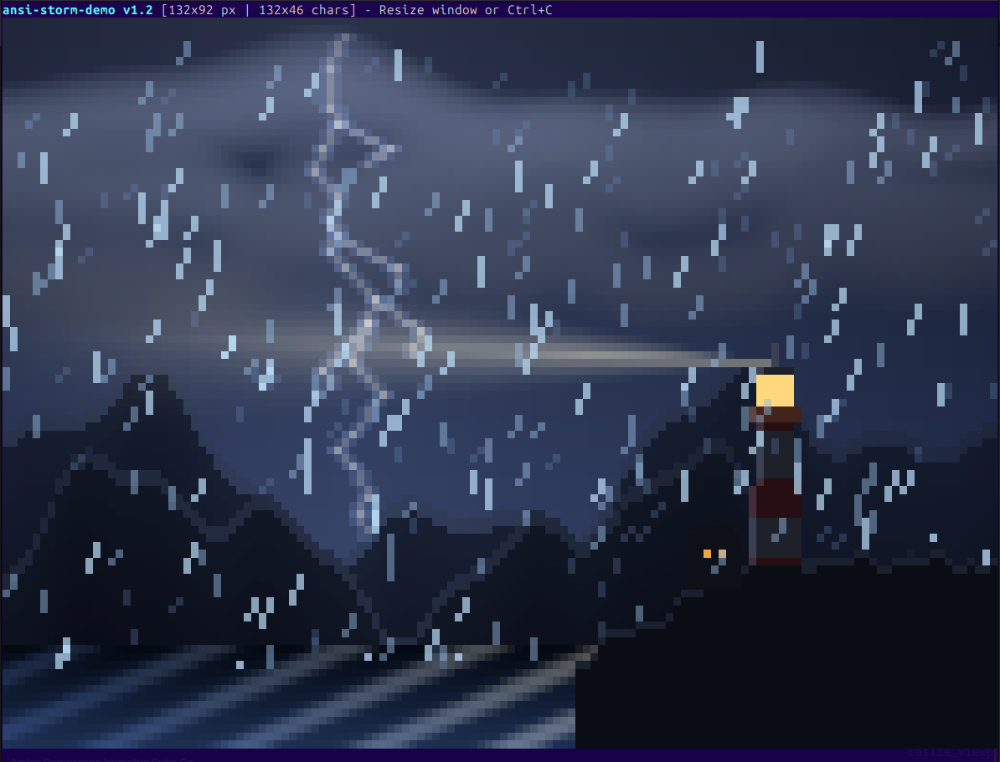

# ansi-storm

A real-time 24-bit TrueColor terminal thunderstorm demo in C.

It uses a sub-pixel framebuffer rendered via Unicode upper-half blocks (▀) so every terminal character cell displays two vertical pixels—giving you 80×48 pixel resolution inside an 80×24 terminal window.

